# Fleet Operations Analytics — Microsoft Fabric Eventhouse & Warehouse

An end-to-end Microsoft Fabric portfolio project demonstrating streaming telemetry ingestion, real-time analytics, medallion architecture, data quality validation, and Power BI reporting.

The project uses sample bus telemetry to demonstrate how data flows from Eventstream and Eventhouse into a Fabric Warehouse, where it is transformed into analytical datasets and consumed through a Power BI semantic model and report.

## Project Overview

| Component | Fabric Item |
|---|---|
| Workspace | `FABRIC-REALTIME-WH-DEV` |
| Eventhouse | `eh_fleet_operations` |
| Eventstream | `es_fleet_telemetry` |
| Eventstream Source | `src_buses_sample` |
| Eventhouse Table | `FleetTelemetry` |
| Data Pipeline | `pl_eventhouse_to_warehouse` |
| Warehouse | `wh_fleet_operations` |
| Gold Fact Table | `dbo.FactFleetTelemetryGold` |
| Gold KPI View | `dbo.vw_FleetDailyKPI_Gold` |
| Power BI Semantic Model | `wh_fleet_operations` |
| Power BI Report | `wh_fleet_operations` |

## Architecture

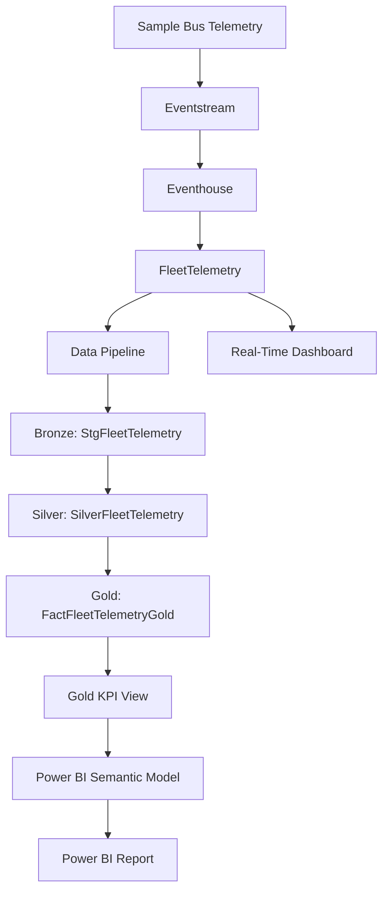

### Architecture explanation

1. **Source and ingestion:** Fabric sample Buses telemetry is ingested through Eventstream.
2. **Real-time storage:** Eventhouse stores telemetry in the `FleetTelemetry` table for KQL exploration and real-time monitoring.
3. **Data movement:** A Fabric Data Pipeline copies and projects telemetry from Eventhouse into the Warehouse staging table.
4. **Bronze:** Original staged telemetry records are retained in `dbo.StgFleetTelemetry`.
5. **Silver:** Exact full-payload grouping is applied, with source-copy counts retained for lineage.
6. **Gold:** Curated telemetry is stored in `dbo.FactFleetTelemetryGold`, with date, bus-line and station dimension keys.
7. **Reporting:** `dbo.vw_FleetDailyKPI_Gold` provides aggregated metrics for the Power BI semantic model.
8. **Visualization:** Power BI presents fleet telemetry trends, bus-state distribution, bus-line comparisons and ETA analysis.

A separate Eventhouse Real-Time Dashboard provides Eventhouse-oriented monitoring.

## Validated Data Results

The following values represent the validated Warehouse snapshot from the project build.

| Metric | Result |
|---|---:|
| Bronze staging rows | 5,996,018 |
| Silver distinct complete-payload groups | 1,799,554 |
| Gold fact rows | 1,799,554 |
| Original source rows represented | 5,996,018 |
| Exact-payload excess rows | 4,196,464 |
| Maximum copies in one payload group | 4 |
| Bus lines covered | 41 |
| Dates covered | 4 |
| Daily bus-line KPI records | 164 |

### Reconciliation

```text
Bronze staging rows
    = Silver payload groups
    + Exact-payload excess rows

5,996,018
    = 1,799,554
    + 4,196,464
```

The exact-payload grouping reduced the Silver row count by approximately **69.99%** compared with the Bronze snapshot.

This is a reduction in row count under the selected grouping policy. It is not a measured physical storage or capacity-cost saving.

## Medallion Architecture

### Bronze Layer

**Table:** `dbo.StgFleetTelemetry`

Responsibilities:
- Retain the staged source projection.
- Preserve original source rows for traceability.
- Provide a basis for reprocessing and data-quality investigations.

### Silver Layer

**Table:** `dbo.SilverFleetTelemetry`

The Silver transformation groups records using all eight projected payload attributes:

1. `EventTimestamp`
2. `TripId`
3. `BusLine`
4. `StationNumber`
5. `ScheduleTime`
6. `BusState`
7. `TimeToNextStation`
8. `PropertiesJson`

The table retains:
- `SourceCopies`
- `DuplicateExcessRows`

This preserves the relationship between grouped payloads and their original staging-row counts.

### Gold Layer

**Table:** `dbo.FactFleetTelemetryGold`

Responsibilities:
- Store analytics-ready telemetry.
- Link records to date, bus-line and station dimensions.
- Retain source-copy and excess-row lineage.
- Store time-to-next-station values in seconds.
- Provide a foundation for reporting.

### Dimension Tables

- `dbo.DimDate`
- `dbo.DimBusLine`
- `dbo.DimStation`

### Gold KPI View

**View:** `dbo.vw_FleetDailyKPI_Gold`

**Grain:** One row per calendar date and bus line.

Metrics include:
- Unique payload rows
- Source rows received
- Exact-payload excess rows
- Distinct Trip IDs
- Arrived payload rows
- In-motion payload rows
- Not-in-station payload rows
- Average ETA in seconds

The validated view contained 164 records, representing four dates and 41 bus lines.

## Power BI Report

The Power BI report connects to the Fabric Warehouse through its SQL endpoint using Import mode.

The semantic model contains explicit measures for:

- Unique Payload Rows
- Source Rows Received
- Exact-Payload Excess Rows
- Bus Lines Covered
- Weighted Average ETA (Seconds)

The report definition includes:

- Fleet telemetry KPI cards
- Daily Fleet Telemetry Trend
- Bus State Distribution
- Top 10 Bus Lines by Telemetry Volume
- Average ETA by Bus Line

**Refresh consideration:** Import mode stores a snapshot in the Power BI semantic model. New Warehouse data requires a semantic-model refresh. The Warehouse and configured refresh identity must remain available and authorized.

## Screenshots and Implementation Evidence

The following screenshots document the implementation stages in Microsoft Fabric and Power BI.

### 1. Workspace and Eventstream

**Workspace Overview**

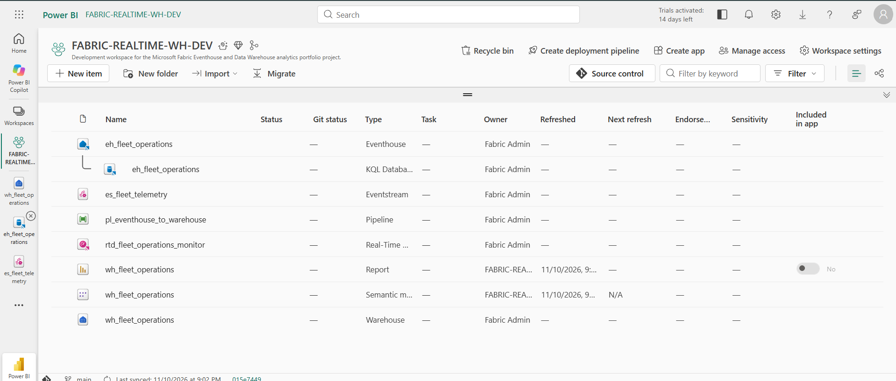

**Eventstream Configuration**

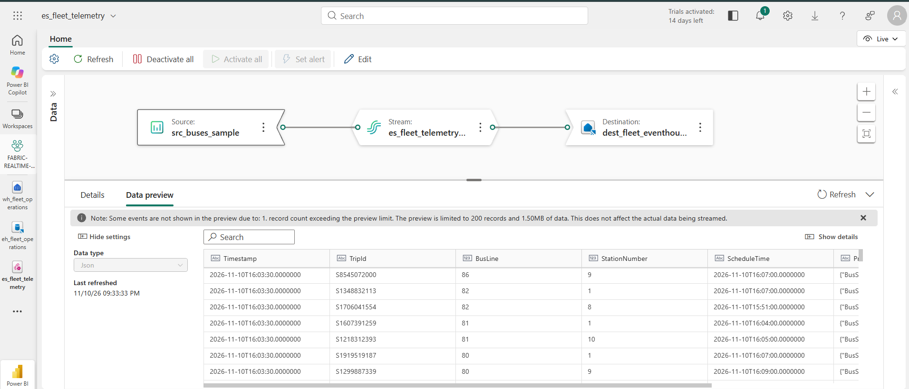

**Eventstream Data Preview**

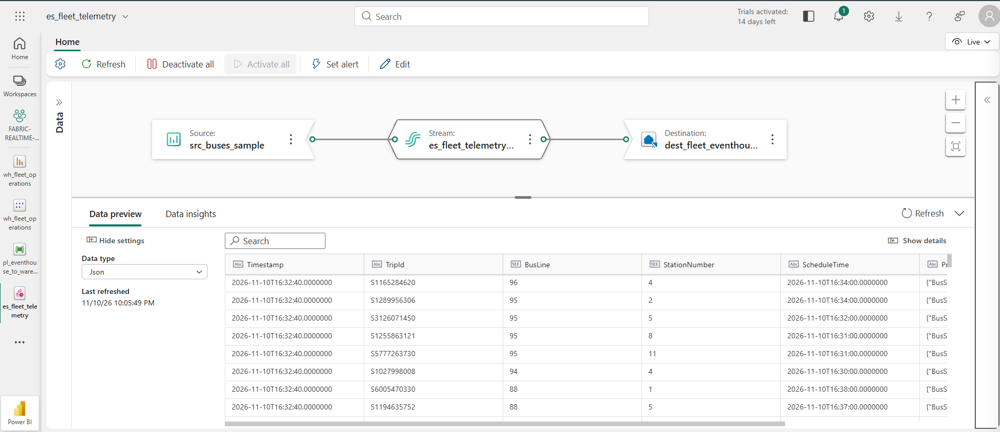

### 2. Eventhouse and Real-Time Monitoring

**Eventhouse Database**

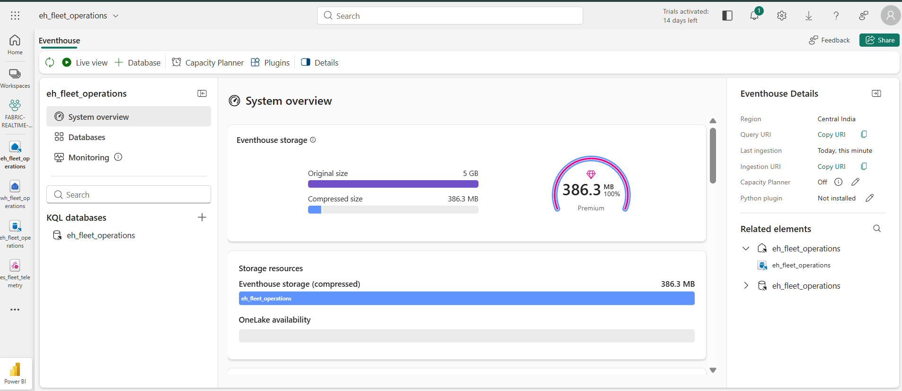

**KQL Query Results**

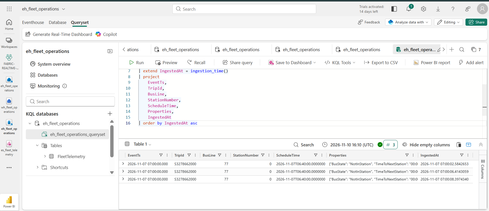

**Real-Time Dashboard**

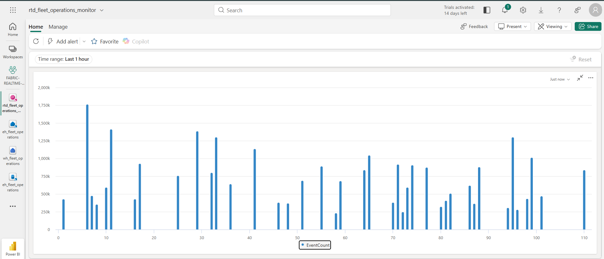

### 3. Data Pipeline and Warehouse

**Eventhouse-to-Warehouse Pipeline**

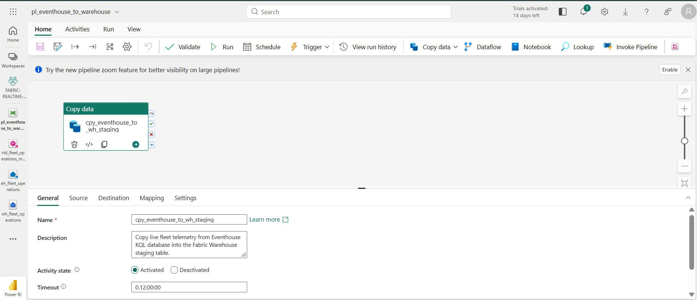

**Successful Pipeline Execution**

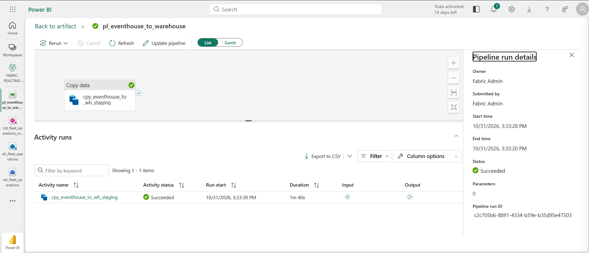

**Warehouse Tables**

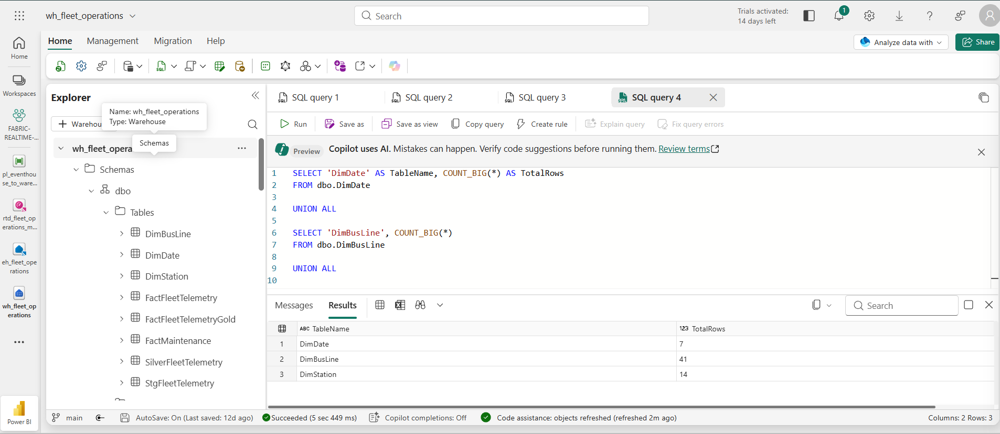

**Warehouse Validation**

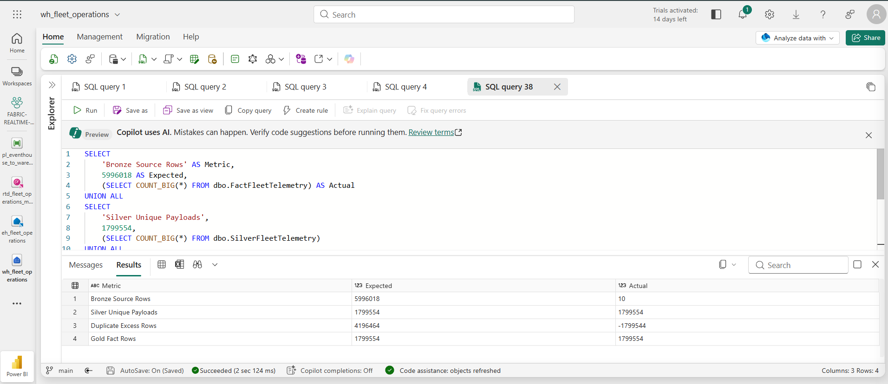

### 4. Semantic Model and Power BI

**Power BI Semantic Model**

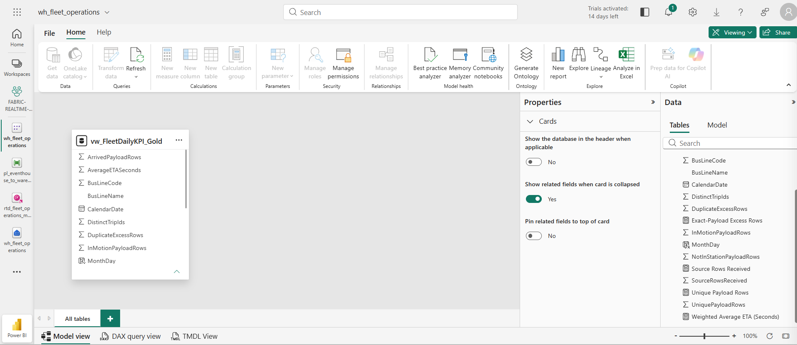

**Fleet Operations Analytics Report**

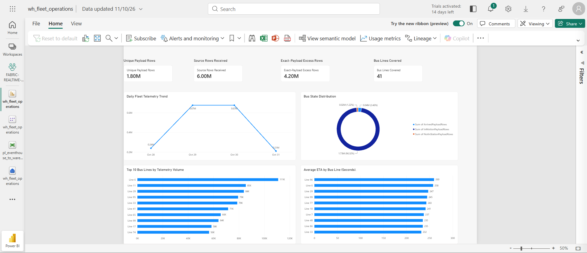

### 5. GitHub Repository

**Repository Overview**

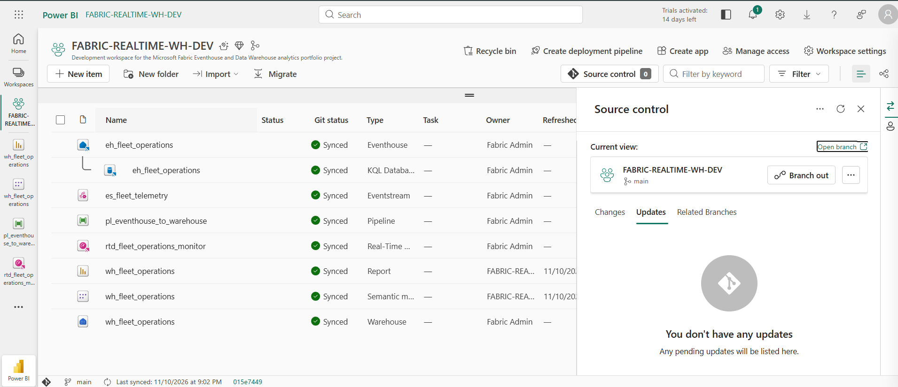

## Repository Structure

```text
fabric-eventhouse-warehouse-analytics/
│
├── eh_fleet_operations.Eventhouse/
│
├── es_fleet_telemetry.Eventstream/
│
├── pl_eventhouse_to_warehouse.DataPipeline/
│
├── rtd_fleet_operations_monitor.KQLDashboard/
│
├── wh_fleet_operations.Report/
│
├── wh_fleet_operations.SemanticModel/
│
├── wh_fleet_operations.Warehouse/
│   └── dbo/
│       ├── Tables/
│       └── Views/
│
├── docs/
│   ├── architecture.md
│   ├── data-quality.md
│   ├── validation-results.md
│   ├── 01-workspace-overview.png
│   ├── 02-eventstream-configuration.png
│   ├── 03-eventstream-data-preview.png
│   ├── 04-eventhouse-database.png
│   ├── 05-eventhouse-kql-query.png
│   ├── 06-realtime-dashboard.png
│   ├── 07-data-pipeline.png
│   ├── 08-pipeline-success.png
│   ├── 09-warehouse-tables.png
│   ├── 10-warehouse-validation.png
│   ├── 11-semantic-model.png
│   ├── 12-powerbi-dashboard.png
│   └── 13-github-repository.png
│
├── LICENSE
└── README.md
```

## Technical Documentation

Additional project documentation:

- [Architecture and Data Flow](docs/architecture.md)
- [Data Quality and Analytical Limitations](docs/data-quality.md)
- [Validation Results](docs/validation-results.md)

## SQL Assets

The Warehouse project includes definitions for:

**Tables**
- `StgFleetTelemetry`
- `SilverFleetTelemetry`
- `FactFleetTelemetryGold`
- `FactFleetTelemetry`
- `DimDate`
- `DimBusLine`
- `DimStation`
- `FactMaintenance`

**Views**
- `vw_FleetDailyKPI`
- `vw_FleetDailyKPI_Gold`
- `vw_MaintenanceKPI`

## Data Quality and Architectural Trade-offs

The sample telemetry source does not expose a verified immutable event identifier.

Consequently, identical payloads cannot conclusively be classified as duplicate real-world events.

The Silver transformation uses **exact full-payload grouping** across eight attributes. It is not hash-based deduplication and does not prove event uniqueness.

The project retains Bronze records and preserves source-copy lineage in Silver and Gold.

Important interpretation rules:

- Unique payload rows are not a proven count of unique physical events or buses.
- Bus-state distribution represents recorded payload rows, not time spent in each state.
- Bus Lines Covered represents distinct bus-line codes in the selected data.
- The four-day snapshot is not sufficient to establish long-term operational or seasonal trends.
- The weighted ETA calculation requires validation against the number of non-NULL ETA observations. If some ETA values are missing, the correct weighting must use valid ETA observation counts rather than all payload rows.

Further details are documented in [data-quality.md](docs/data-quality.md).

## Deployment and Reproducibility Notes

The repository contains exported Fabric item definitions, Warehouse table definitions, SQL views, and Power BI model/report definitions.

Deployment into another workspace requires environment-specific configuration:

1. Create or select a Fabric workspace with appropriate capacity and permissions.
2. Configure the Eventhouse, Eventstream and Warehouse resources.
3. Update source and destination bindings and connection references.
4. Deploy the Warehouse schema and dimension tables.
5. Execute the Bronze-to-Silver and Silver-to-Gold population transformations.
6. Run the reconciliation and dimension-coverage validation queries.
7. Configure the semantic model and report against the target Warehouse SQL endpoint.
8. Refresh the Power BI Import model.

**Reproducibility limitation:** The repository currently contains the Warehouse table DDL and KPI view definitions, but does not yet package every ordered data-population SQL script used during the project build. The dimension-loading, Bronze-to-Silver and Silver-to-Gold execution scripts should be added before describing the repository as fully reproducible from scratch.

## Security Considerations

- Do not commit passwords, access tokens, credentials or private keys.
- Review exported endpoint names and resource identifiers before sharing publicly.
- Use synthetic or approved sample data in public portfolio material.
- Check organizational approval before publishing screenshots or data from company environments.
- Configure authentication and permissions separately in each deployment environment.


## Author

**Soyeb Diwan**

Microsoft Fabric | Data Engineering | Power BI | Analytics

- GitHub: [@siddiwan0528](https://github.com/siddiwan0528)
- Project: Fleet Operations Analytics
- Technologies: Microsoft Fabric, Eventhouse, Eventstream, KQL, SQL, Power BI and DAX

This project was designed and implemented as a hands-on Microsoft Fabric data engineering and analytics portfolio project.


## License

This project is distributed under the MIT License. See [LICENSE](LICENSE) for details.

---

**Project:** Fleet Operations Analytics  
**Platform:** Microsoft Fabric  
**Reporting:** Power BI  
**Purpose:** End-to-end data engineering and analytics portfolio project
