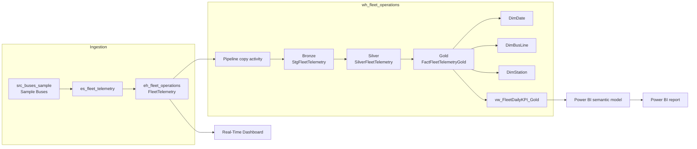

# Architecture and data flow

## 1. Overview

The project demonstrates a sample telemetry path from a Fabric Eventstream into Eventhouse, then into a Fabric Warehouse for medallion-style analytical processing. A Power BI semantic model and report consume the Gold KPI view. A separate Real-Time Dashboard provides Eventhouse-oriented monitoring.

## 2. Logical architecture



## 3. Ingestion layer

### Eventstream

- Item: `es_fleet_telemetry`
- Source node: `src_buses_sample`
- Source type: Fabric sample data, Buses
- Destination: `dest_fleet_eventhouse`

The Eventstream routes the sample telemetry stream to the Eventhouse destination.

### Eventhouse

- Item: `eh_fleet_operations`
- KQL database table: `FleetTelemetry`

The table schema in the committed KQL database definition includes:
- `Timestamp` (string)
- `TripId` (string)
- `BusLine` (long)
- `StationNumber` (long)
- `ScheduleTime` (string)
- `Properties` (string containing JSON properties)

The pipeline parses `Properties` to project the bus state and time-to-next-station fields. The timestamp is converted from string to datetime during projection.

## 4. Eventhouse-to-Warehouse pipeline

Pipeline: `pl_eventhouse_to_warehouse`

Copy activity: `cpy_eventhouse_to_wh_staging`

Source query (simplified from the committed pipeline definition):

```kusto
FleetTelemetry
| extend Props = parse_json(Properties)
| project
    EventTimestamp = todatetime(Timestamp),
    TripId = tostring(TripId),
    BusLine = toint(BusLine),
    StationNumber = toint(StationNumber),
    ScheduleTime = todatetime(ScheduleTime),
    BusState = tostring(Props.BusState),
    TimeToNextStation = tostring(Props.TimeToNextStation),
    PropertiesJson = tostring(Properties)
```

Sink:
- Warehouse: `wh_fleet_operations`
- Schema/table: `dbo.StgFleetTelemetry`
- Write behavior in the committed pipeline definition: Insert

The pipeline is an ingestion/copy step. Silver and Gold transformations are implemented as Warehouse SQL objects and executed separately.

## 5. Warehouse medallion layers

| Layer | Object | Responsibility |
|---|---|---|
| Bronze | `dbo.StgFleetTelemetry` | Staged source projection |
| Silver | `dbo.SilverFleetTelemetry` | Exact full-payload grouping and copy-count lineage |
| Gold | `dbo.FactFleetTelemetryGold` | Analytics-ready fact rows with dimension keys |
| Gold serving | `dbo.vw_FleetDailyKPI_Gold` | Daily and bus-line aggregates for reporting |

### Dimensions

- `dbo.DimDate`
- `dbo.DimBusLine`
- `dbo.DimStation`

The Gold fact joins to date and bus-line dimensions in the KPI view. Station keys are retained in the fact for station-level analysis.

## 6. KPI serving layer

View: `dbo.vw_FleetDailyKPI_Gold`

Grain: one row per calendar date and bus line.

Metrics include:
- Unique payload rows
- Source rows received (sum of source copies)
- Exact-payload excess rows
- Distinct trip IDs
- Payload counts by bus state
- Average time to next station in seconds

The view returned 164 rows for the validated snapshot: four dates multiplied by 41 represented bus lines.

## 7. Power BI

The semantic model imports `dbo.vw_FleetDailyKPI_Gold` from the Warehouse SQL endpoint. Explicit measures are defined in the semantic model for row counts, bus-line coverage and weighted ETA.

The report provides high-level KPI cards, a daily trend, state distribution, bus-line comparisons and ETA analysis.

**Refresh behavior:** Import mode stores a model snapshot in Power BI. A refresh is required to load later changes from the Warehouse. The Warehouse must be available and accessible to the refresh identity.

## 8. Environment-specific deployment notes

The repository contains Fabric item definitions, but deployment is not guaranteed to be a one-click process across tenants. Review connection references and configure:
- Workspace and item IDs
- Eventhouse and Warehouse endpoints
- Authentication and permissions
- Capacity assignment and trial/paid entitlement
- Source and destination bindings

Do not commit secrets or personal access tokens.
